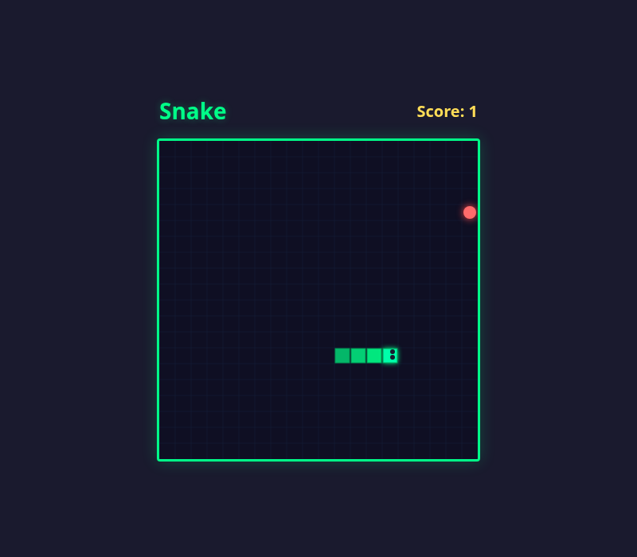

# Snake Game

  

  <strong>A classic Snake game built with HTML5 Canvas, CSS, and JavaScript.</strong> 
  Fully self-contained in a single HTML file with no external dependencies.

  <a href="#how-to-play">How to Play</a> •
  <a href="#features">Features</a> •
  <a href="#technical-details">Technical Details</a>

---

## How to Play

<table>
  <tr>
    <td width="50%">
      <ol>
        <li>Open <code>index.html</code> in any modern web browser.</li>
        <li>Click <strong>Start Game</strong> or press any arrow key to begin.</li>
        <li>Use the <strong>arrow keys</strong> to control the snake's direction.</li>
        <li>Eat the red food to grow longer and increase your score.</li>
        <li>Avoid hitting the walls or your own tail.</li>
        <li>When the game ends, press <strong>Enter</strong> or click <strong>Play Again</strong> to restart.</li>
      </ol>
    </td>
    <td width="50%">
      <h4>🎮 Controls</h4>
      <table>
        <tr><td>⬆️</td><td>Move Up</td></tr>
        <tr><td>⬇️</td><td>Move Down</td></tr>
        <tr><td>⬅️</td><td>Move Left</td></tr>
        <tr><td>➡️</td><td>Move Right</td></tr>
      </table>
    </td>
  </tr>
</table>

## Features

| Feature | Description |
|---------|-------------|
| 🎨 **Smooth Rendering** | Canvas-based rendering on a 20x20 grid |
| 📊 **Score Tracking** | On-screen score display |
| 🚀 **Start Screen** | Instructions displayed before gameplay |
| 💀 **Game Over Screen** | Final score with restart option |
| ✨ **Visual Polish** | Gradient snake, glowing food, subtle grid, animated eyes |
| 📦 **Zero Dependencies** | No external libraries required |

## Technical Details

Click to expand technical specifications

 

- **Technology**: Pure HTML5, CSS, and JavaScript
- **Canvas Size**: 400×400 pixels
- **Grid**: 20×20 cells (20px per cell)
- **Game Speed**: ~8 frames per second
- **Collision Detection**: Walls and self-intersection

---

  Built with ❤️ using vanilla JavaScript

